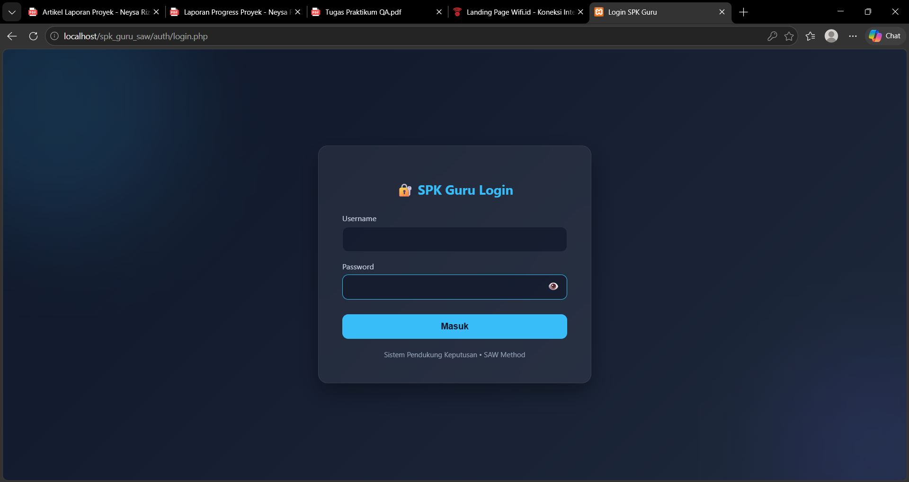
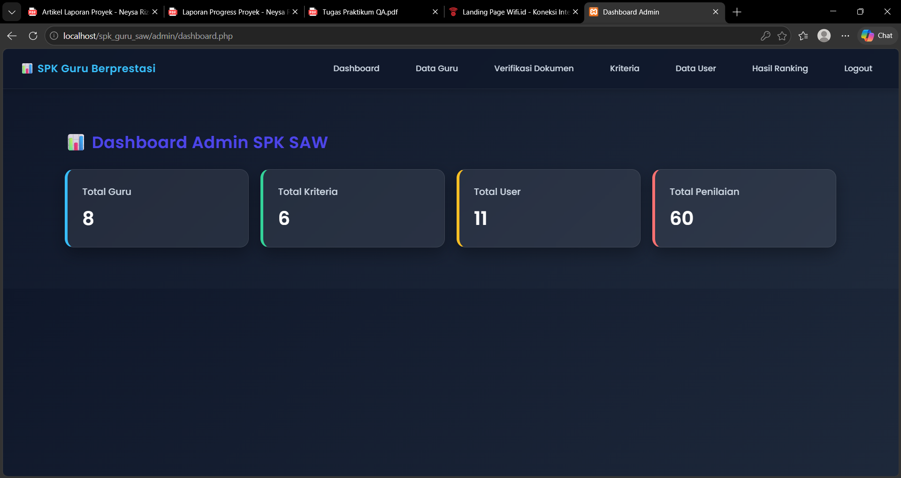
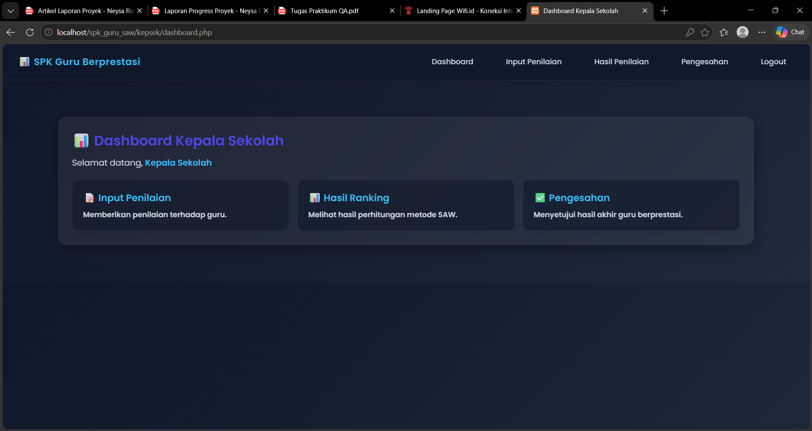
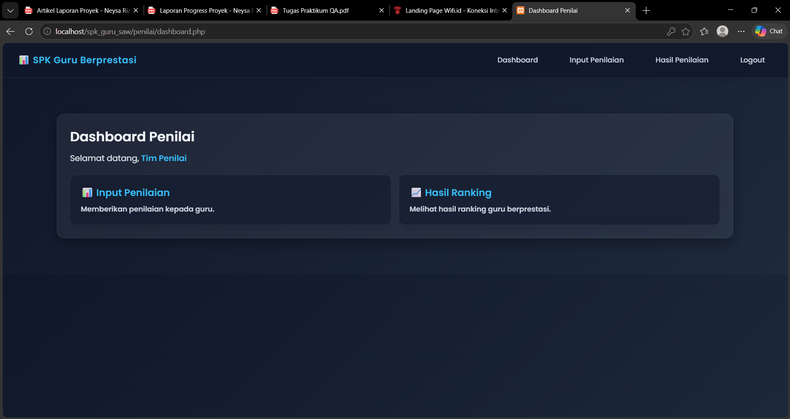
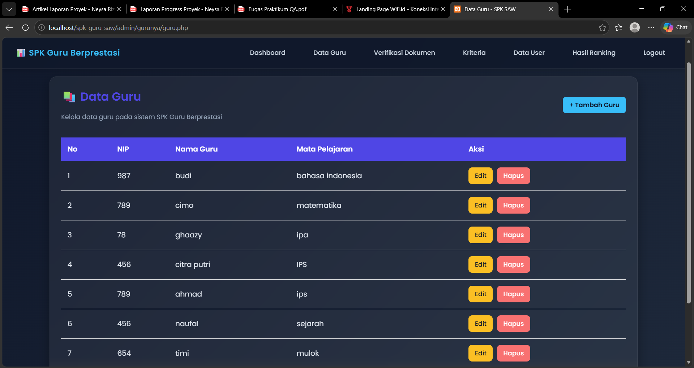
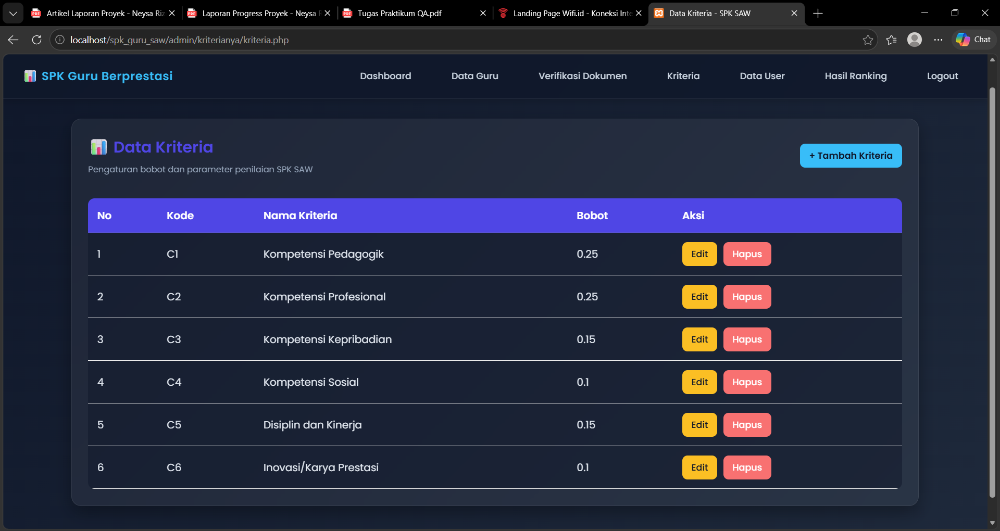
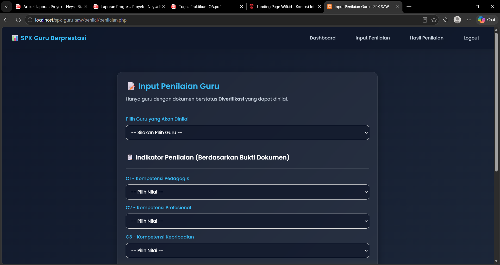
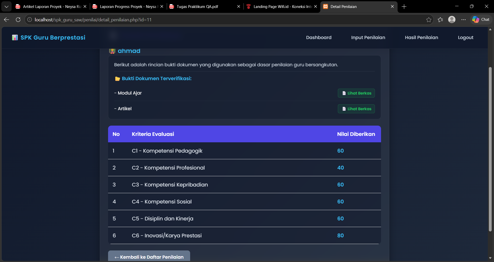
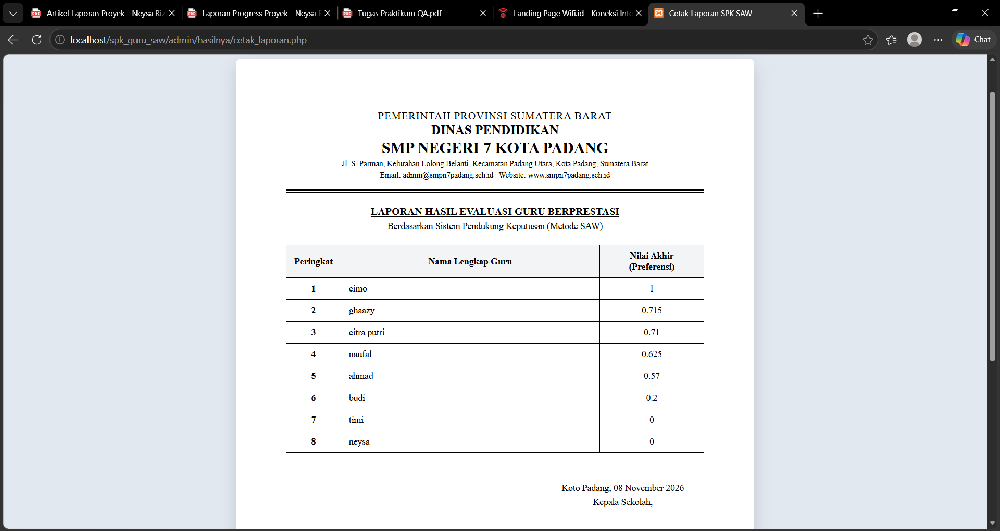

# 04 Test Strategy Plan

Test Strategy & Test Plan (P04)

## Tujuan dan ruang lingkup pengujian

- Menentukan tujuan pengujian untuk memastikan sistem berjalan sesuai kebutuhan.

- In-scope: Login, hak akses, pengelolaan data guru, data pengguna, kriteria, input penilaian, perhitungan SAW, ranking, pengesahan, dan cetak laporan.

- Out-of-scope: Pengujian keamanan tingkat lanjut, pengujian ribuan pengguna secara bersamaan, dan integrasi dengan sistem eksternal.

- Test level dan test type

- Test Level:

| Jenis | Penerapan |
| --- | --- |
| System Testing | Menguji keseluruhan fungsi aplikasi. |
| Integration Testing | Menguji hubungan frontend, backend, dan database. |
| Acceptance Testing | Memastikan sistem sesuai kebutuhan pengguna. |

- Test Type

| Jenis | Penerapan |
| --- | --- |
| Functional Testing | Menguji fungsi login, CRUD, penilaian, dan laporan. |
| Negative Testing | Menguji input salah atau kosong. |
| Authorization Testing | Menguji pembatasan hak akses pengguna. |
| Calculation Testing | Menguji perhitungan metode SAW. |
| Data Integrity Testing | Menguji konsistensi penyimpanan data. |

- Dokumentasikan environment, versi aplikasi, data uji, serta pembagian peran

- Environment

| No. | Komponen | Keterangan |
| --- | --- | --- |
| 1 | Jenis aplikasi | Apk Berbasis Web |
| 2 | Browser | Chrome,Edge,Google |
| 3 | Versi browser | - |
| 4 | Sistem operasi | Windows |
| 5 | Perangkat | Laptop/PC |
| 6 | Frontend | HTML,CSS |
| 7 | Backend | PHP |
| 8 | Database | MySQL |
| 9 | Koneksi | Lokal Host |

- Dokumentasi versi aplikasi

| Informasi | Keterangan | Dokumentasi |
| --- | --- | --- |
| Nama Aplikasi | SPK Pemilihan Guru Berprestasi |  |
| Versi Aplikasi | Versi 1.0 (Versi pengujian) | - |
| Status | Testing (Aplikasi dalam tahap pengujian) |  |
| Tanggal Pengujian | 5 November 2026 | - |

- Dokumentasi data uji

| No | Data Uji | Foto |
| --- | --- | --- |
| 1 | Akun Admin |  |
| 2 | Akun Kepala Sekolah |  |
| 3 | Akun Penilai |  |
| 4 | Data guru |  |
| 5 | Kriteria dan bobot SAW |  |
| 6 | Data penilaian |  |
| 7 | Hasil perhitungan dan ranking |   |

- Dokumentasi pembagian peran

| No | Peran | Tanggung jawab | Nama |
| --- | --- | --- | --- |
| 1 | Tester Admin | Menguji fitur Admin | Ratu Intan Muliani |
| 2 | Tester Kepala Sekolah | Menguji fitur Kepala Sekolah | Zharif Pratama |
| 3 | Tester Penilai | Menguji fitur Penilai | Sultan Rafif Sidik |
| 4 | Dokumentasi | Mengumpulkan bukti pengujian | Neysa Rizqi Putri Bustami |

- Entry Criteria, Exit Criteria, Quality Gate, dan Jadwal

- Entry Criteria (Syarat Memulai Pengujian)

- Pengujian dapat dimulai apabila:

- Aplikasi dapat dijalankan.

- Database sudah terhubung.

- Akun ketiga pengguna (Admin, Kepala Sekolah, dan Penilai) tersedia.

- Data pengujian sudah disiapkan.

- Fitur yang akan diuji sudah tersedia.

- Exit Criteria (Syarat Menyelesaikan Pengujian)

- Pengujian dianggap selesai apabila:

- Seluruh test case sudah dijalankan atau diberikan status.

- Hasil aktual pengujian sudah dicatat.

- Bukti pengujian berupa screenshot tersedia.

- Tidak ada defect kritis yang belum ditangani tanpa keputusan risiko.

## Hasil pengujian sudah didokumentasikan.

- Quality Gate (Standar Kelulusan Pengujian)

| No | Kriteria | Standar Kelulusan |
| --- | --- | --- |
| 1 | Fungsi login | Setiap pengguna dapat login sesuai hak aksesnya. |
| 2 | Hak akses | Pengguna hanya dapat mengakses fitur sesuai perannya. |
| 3 | Pengelolaan data | Data gur0075, pengguna, dan kriteria dapat dikelola dengan baik. |
| 4 | Perhitungan SAW | Normalisasi dan perhitungan nilai akhir berjalan sesuai rumus SAW. |
| 5 | Hasil perankingan | Sistem menampilkan peringkat guru berdasarkan hasil perhitungan. |
| 6 | Laporan | Hasil pengujian dan laporan dapat ditampilkan atau dicetak. |

- Jadwal Pengujian

| No | Kegiatan | Waktu Pelaksanaan |
| --- | --- | --- |
| 1 | Persiapan aplikasi dan data pengujian | Kamis, 5 November 2026 s.d Minggu, 8 November 2026 |
| 2 | Pengujian fitur Admin | Kamis, 5 November 2026 s.d Minggu, 8 November 2026 |
| 3 | Pengujian fitur Kepala Sekolah | Kamis, 5 November 2026 s.d Minggu, 8 November 2026 |
| 4 | Pengujian fitur Penilai | Kamis, 5 November 2026 s.d Minggu, 8 November 2026 |
| 5 | Pengujian perhitungan SAW dan hasil ranking | Kamis, 5 November 2026 s.d Minggu, 8 November 2026 |
| 6 | Dokumentasi dan penyusunan laporan | Kamis, 5 November 2026 s.d Minggu, 8 November 2026 |

## Lampiran gambar dari dokumen Word

