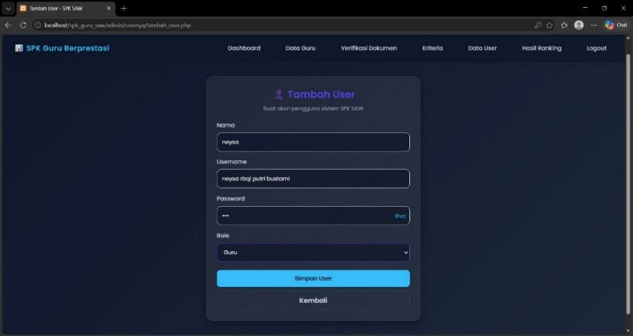
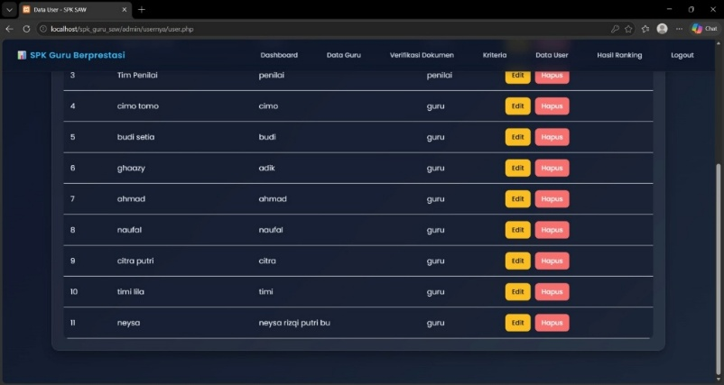
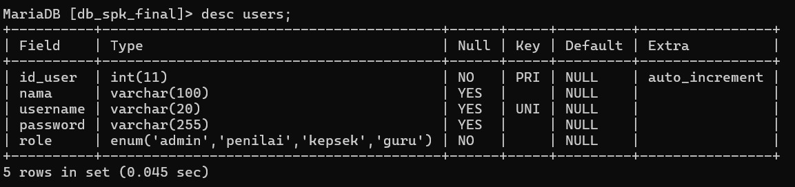

# 07 Defect Report RCA

## DEFECT REPORT, TRIAGE & ROOT CAUSE (P07)

## RINGKASAN HASIL PENGUJIAN TAHAP 6

Berdasarkan dokumen Tahap 6 (Black-Box Test Design & Execution), pengujian dilakukan menggunakan empat metode, yaitu Equivalence Partitioning, Boundary Value Analysis, Decision Table, dan State Transition.

## Hasil Pengujian Equivalence Partitioning

| No. | Test Case ID | Fitur yang Diuji | Status |
| --- | --- | --- | --- |
| 1 | TC-ADM-001 | Login Admin | Passed |
| 2 | TC-ADM-003 | Menambahkan data guru | Passed |
| 3 | TC-TIM-004 | Validasi penilaian yang belum lengkap | Passed |

## Hasil Pengujian Boundary Value Analysis

| No. | Test Case ID | Fitur yang Diuji | Status |
| --- | --- | --- | --- |
| 1 | TC-TIM-002 | Kategori indikator terendah | Passed |
| 2 | TC-TIM-003 | Kategori indikator tertinggi | Passed |
| 3 | TC-ADM-002 | Batas maksimum panjang username | Failed |

## Hasil Pengujian Decision Table

| No. | Test Case ID | Fitur yang Diuji | Status |
| --- | --- | --- | --- |
| 1 | TC-ADM-001 | Kombinasi username dan password pada login Admin | Passed |

## Hasil Pengujian State Transition

| No. | Test Case ID | Fitur yang Diuji | Status |
| --- | --- | --- | --- |
| 1 | TC-GUR-003 | Pengujian transisi status pada proses guru | Passed |
| 2 | TC-ADM-006 | Pengujian transisi status pada proses Admin | Passed |
| 3 | TC-TIM-005 | Pengujian transisi status pada proses Penampilan data Guru pada Tim penilai | Passed |
| 4 | TC-TIM-006 | Pengujian transisi status pada proses Tim Penilai | Passed |

## Rekapitulasi Hasil Pengujian

Berdasarkan seluruh catatan pengujian yang memiliki status eksplisit, diperoleh hasil sebagai berikut:

| No. | Status Pengujian | Jumlah |
| --- | --- | --- |
| 1 | Passed | 10 |
| 2 | Failed | 1 |
|  | Total | 11 |

Dari hasil tersebut, terdapat 10 pengujian yang berhasil dan 1 pengujian yang berstatus Failed.

Pengujian yang berstatus Failed adalah TC-ADM-002, yaitu pengujian batas maksimum panjang username pada modul Admin.

Oleh karena itu, TC-ADM-002 menjadi fokus utama dalam proses identifikasi dan analisis defect pada Tahap 7.

## IDENTIFIKASI DEFECT

- Temuan Defect

- Berdasarkan hasil pengujian Tahap 6, terdapat satu test case dengan status Failed, yaitu TC-ADM-002.

- Pengujian tersebut dilakukan untuk memastikan bahwa sistem dapat membatasi panjang username sesuai ketentuan maksimal 20 karakter.

- Pada dokumen Tahap 6, Actual Result menyatakan bahwa sistem menolak username yang melebihi batas maksimum. Namun, status pengujian dicatat sebagai Failed.

- Sementara itu, pemeriksaan terhadap evidence EV-006 sebelumnya menunjukkan indikasi bahwa username tetap diproses dan ditampilkan dalam kondisi terpotong.

- Dengan demikian, terdapat ketidaksesuaian antara keterangan Actual Result dan bukti pengujian yang perlu diselesaikan melalui verifikasi.

- Identitas Temuan

| Komponen | Keterangan |
| --- | --- |
| Defect ID | DEF-001 (sementara) |
| Test Case ID | TC-ADM-002 |
| Modul | Admin – Data User |
| Defect Title | Validasi panjang maksimum username |
| Environment | Belum dilengkapi |
| Precondition | Administrator telah login dan berada pada menu Data User |
| Severity | Medium (usulan sementara) |
| Priority | Medium (usulan sementara) |
| Status Triage | Need Investigation |

- Deskripsi Temuan

- Temuan berkaitan dengan validasi panjang username pada fitur penambahan pengguna. Pengujian dilakukan dengan memasukkan username yang melebihi batas maksimum 20 karakter. Berdasarkan struktur database pada evidence EV-006C, kolom username menggunakan tipe data varchar(20).

- Artinya, kolom tersebut memiliki kapasitas penyimpanan maksimal 20 karakter. Apabila sistem menerima username yang lebih panjang tanpa melakukan validasi terlebih dahulu, terdapat kemungkinan data username yang ditampilkan atau disimpan menjadi tidak sesuai dengan input awal. Oleh karena itu, diperlukan pemeriksaan lebih lanjut untuk memastikan apakah sistem sudah menolak input tersebut sesuai dengan ketentuan.

## DEFECT REPORT

- Defect ID: DEF-001

- Judul Defect: Sistem tidak melakukan validasi panjang maksimum username dengan benar.

| Komponen | Keterangan |
| --- | --- |
| Defect ID | DEF-001 |
| Related Test Case | TC-ADM-002 |
| Module | Admin – Data User |
| Category | Input Validation |
| Expected Result | Username lebih dari 20 karakter ditolak |
| Actual Result | Perlu dicocokkan dengan evidence EV-006 |
| Evidence | EV-006A, EV-006B, EV-006C |
| Severity | Medium (sementara) |
| Priority | Medium (sementara) |
| Status | Need Verification |

- Steps to Reproduce

- Langkah-langkah untuk melakukan pengujian ulang terhadap masalah tersebut adalah:

- Buka aplikasi SPK Guru Berprestasi.

- Login menggunakan akun Administrator.

- Masuk ke menu Data User.

- Pilih fitur Tambah User.

- Masukkan nama pengguna.

- Masukkan username yang melebihi 20 karakter.

- Contoh username: neysa rizqi putri bustami.

- Lengkapi data pengguna lainnya sesuai kebutuhan form.

- Klik tombol Simpan User.

- Amati respons sistem.

- Periksa apakah pengguna berhasil ditambahkan dan bagaimana username ditampilkan pada daftar pengguna.

- Expected Result

- Sistem seharusnya menolak username yang melebihi batas maksimum 20 karakter. Apabila administrator memasukkan username dengan panjang lebih dari 20 karakter, sistem harus menampilkan pesan kesalahan dan menghentikan proses penyimpanan data. Dengan demikian, hanya username yang memenuhi ketentuan panjang yang dapat diproses oleh sistem.

- Actual Result

- Pada dokumen Tahap 6, hasil aktual dicatat bahwa sistem menolak username yang panjangnya berada di luar batas maksimum. Namun, evidence EV-006 perlu dicocokkan kembali karena terdapat indikasi bahwa pengguna tetap berhasil ditambahkan dan username yang ditampilkan pada daftar pengguna menjadi terpotong. Oleh karena itu, Actual Result final akan ditetapkan setelah pemeriksaan ulang terhadap evidence dan perilaku aplikasi.

- Evidence Defect

- Bukti pengujian yang digunakan untuk memeriksa DEF-001 terdiri dari tiga gambar.

- Gambar 1. EV-006A – Form Tambah User

- Screenshot menunjukkan proses pengisian data pengguna pada form Tambah User, termasuk username yang digunakan dalam pengujian.

- Gambar 2. EV-006B – Daftar User

- Screenshot digunakan untuk memeriksa apakah data pengguna berhasil ditambahkan dan apakah username yang ditampilkan sesuai dengan input awal.

- Gambar 3. EV-006C – Struktur Tabel Database

- Screenshot menunjukkan struktur tabel database dengan kolom username bertipe data varchar(20).

- Ketiga evidence tersebut digunakan untuk membandingkan input username, respons aplikasi, dan batas penyimpanan pada database.

## TRIAGE – SEVERITY, PRIORITY, DAN TINDAKAN

Triage merupakan proses pemeriksaan dan penentuan tindak lanjut terhadap temuan pengujian. Tujuan triage adalah menentukan apakah suatu temuan benar-benar merupakan defect serta menetapkan tingkat keparahan dan prioritas perbaikannya.

- Severity

- Severity merupakan tingkat keparahan defect berdasarkan dampak yang ditimbulkan terhadap aplikasi.

- Penilaian sementara untuk DEF-001 adalah:

- Severity: Medium

- Alasan:

- Apabila sistem terbukti menerima username yang melebihi batas maksimum dan menyebabkan username terpotong, hal tersebut dapat mengakibatkan ketidaksesuaian data pengguna.

- Masalah ini dapat mengganggu pengelolaan data akun, tetapi belum terdapat bukti bahwa seluruh fungsi aplikasi berhenti beroperasi.

- Penilaian ini masih bersifat sementara sampai perilaku aplikasi dipastikan.

- Priority

- Priority merupakan tingkat urgensi suatu defect untuk segera diperbaiki.

- Penilaian sementara untuk DEF-001 adalah:

- Priority: Medium

- Alasan:

- Validasi username perlu diperbaiki apabila terbukti tidak berjalan dengan benar agar data pengguna dapat disimpan sesuai ketentuan. Namun, berdasarkan bukti yang tersedia saat ini, masalah tersebut belum terbukti menghentikan keseluruhan fungsi utama aplikasi.

## Triage Action

- Tindakan triage sementara adalah:

- Need Investigation

- Langkah tindak lanjut:

- Memeriksa kembali screenshot EV-006A.

- Memastikan hasil penambahan pengguna melalui EV-006B.

- Memeriksa batas panjang kolom username melalui EV-006C.

- Membandingkan Expected Result dan Actual Result.

- Memeriksa implementasi validasi username pada aplikasi.

- Menetapkan status defect setelah seluruh bukti diverifikasi.

## ROOT CAUSE ANALYSIS (MINI 5-WHY)

Root Cause Analysis merupakan proses analisis untuk mencari kemungkinan penyebab utama terjadinya suatu masalah. Pada laporan ini digunakan metode 5-Why, yaitu mengajukan pertanyaan mengapa secara berurutan untuk mengetahui kemungkinan sumber permasalahan.

- Permasalahan

- Terdapat ketidaksesuaian pada hasil pengujian validasi panjang maksimum username TC-ADM-002.

- Status pengujian tercatat Failed, sedangkan keterangan Actual Result menyatakan bahwa sistem menolak username yang melebihi batas maksimum.

- Analisis 5-Why

- Why 1 – Mengapa TC-ADM-002 memiliki status Failed?

- Karena hasil pengujian pada dokumen Tahap 6 dicatat sebagai Failed.

- Why 2 – Mengapa status Failed perlu diperiksa kembali?

- Karena keterangan Actual Result menyatakan bahwa sistem berhasil menolak username yang melebihi batas maksimum.

- Why 3 – Mengapa terdapat ketidaksesuaian antara status dan Actual Result?

- Karena terdapat indikasi bahwa perilaku aplikasi yang terlihat pada evidence belum sepenuhnya sesuai dengan keterangan hasil pengujian.

- Why 4 – Mengapa perilaku aplikasi perlu diperiksa lebih lanjut?

- Karena diperlukan pemeriksaan terhadap proses penambahan pengguna dan hasil penyimpanan username untuk mengetahui apakah validasi berjalan dengan benar.

- Why 5 – Mengapa akar masalah belum dapat dipastikan?

- Karena diperlukan pemeriksaan evidence secara menyeluruh dan pemeriksaan implementasi validasi pada kode program aplikasi.

- Kesimpulan Root Cause

- Berdasarkan analisis sementara, akar masalah teknis DEF-001 belum dapat ditentukan secara pasti. Kemungkinan yang perlu diperiksa adalah ketidaksesuaian antara aturan validasi panjang username pada aplikasi dan kapasitas kolom username pada database. Pemeriksaan kode program diperlukan untuk memastikan apakah masalah berasal dari validasi form, validasi sisi server, atau proses penyimpanan data.

## REKOMENDASI PERBAIKAN

Apabila hasil verifikasi membuktikan bahwa sistem masih menerima username yang melebihi 20 karakter, beberapa rekomendasi perbaikan yang dapat diterapkan adalah:

Menambahkan validasi panjang maksimal 20 karakter pada form Tambah User.

Menambahkan validasi pada sisi server sebelum data dikirim ke database.

Menampilkan pesan kesalahan apabila username melebihi batas maksimum.

Menghentikan proses penyimpanan apabila username tidak memenuhi ketentuan.

Memastikan aturan validasi pada aplikasi sesuai dengan struktur kolom database varchar(20).

Melakukan pengujian ulang setelah perbaikan diterapkan.

Contoh pesan kesalahan yang dapat ditampilkan:

"Username tidak boleh lebih dari 20 karakter."

Rekomendasi tersebut bertujuan agar sistem dapat mencegah input username yang tidak sesuai dengan ketentuan sebelum proses penyimpanan dilakukan.

## RETEST RESULT

## Retest merupakan proses pengujian ulang yang dilakukan setelah perbaikan defect diterapkan.

Tujuan retest adalah memastikan bahwa masalah yang ditemukan sebelumnya sudah berhasil diperbaiki dan sistem dapat memberikan hasil sesuai Expected Result.

Pada saat laporan ini dibuat, belum terdapat informasi bahwa perbaikan DEF-001 telah dilakukan. Oleh karena itu, retest belum dapat dinyatakan selesai.

- Rencana Retest

| No. | Skenario Pengujian | Input | Expected Result |
| --- | --- | --- | --- |
| 1 | Username kurang dari batas maksimum | 15 karakter | Sistem menerima username |
| 2 | Username tepat pada batas maksimum | 20 karakter | Sistem menerima username |
| 3 | Username melebihi batas maksimum | 21 karakter atau lebih | Sistem menolak username dan menampilkan pesan kesalahan |

- Hasil Retest Sementara

| Komponen | Keterangan |
| --- | --- |
| Defect ID | DEF-001 |
| Status Perbaikan | Belum dilakukan |
| Retest | Belum dilakukan |
| Retest Result | Belum tersedia |
| Status Sementara | Need Verification |

- Penentuan Status Defect

- Status defect akan ditentukan berdasarkan hasil pengujian ulang.

- Closed: Apabila perbaikan berhasil dan hasil retest sesuai Expected Result.

- Reopened: Apabila defect masih ditemukan setelah perbaikan.

- Open: Apabila defect telah dikonfirmasi tetapi belum diperbaiki.

- Untuk sementara, DEF-001 masih berstatus Need Verification sampai ketidaksesuaian hasil pengujian dan evidence diselesaikan.

## PEMERIKSAAN EVIDENCE LAIN

- Selain TC-ADM-002, terdapat satu hal yang perlu diperhatikan pada dokumentasi TC-TIM-004.

TC-TIM-004 merupakan pengujian yang berkaitan dengan validasi penilaian yang belum lengkap.

Namun, deskripsi evidence EV-003 pada dokumen Tahap 6 menyebutkan screenshot pemberitahuan username duplikat.

Hal tersebut menunjukkan adanya ketidaksesuaian antara keterangan evidence dan skenario pengujian.

Oleh karena itu, perlu dilakukan pemeriksaan terhadap EV-003 untuk memastikan bahwa gambar yang digunakan benar-benar menunjukkan hasil pengujian penilaian yang belum lengkap.

Apabila gambar yang digunakan tidak sesuai, evidence perlu diganti dengan screenshot yang mendukung skenario TC-TIM-004.

## Pemeriksaan ini bertujuan menjaga konsistensi antara Test Case, Actual Result, dan Evidence.

## Lampiran gambar dari dokumen Word

